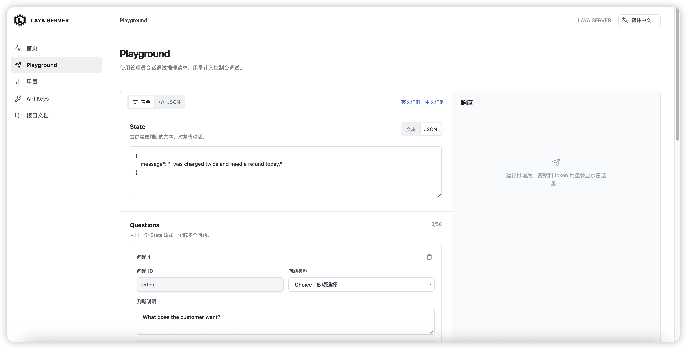

<a href="README.md">English</a> | 简体中文

<p align="center"></p>

<h1 align="center">LAYA SERVER</h1>

<p align="center">
  <a href="https://github.com/1Panel-dev/laya-server/releases"></a>
  <a href="https://github.com/1Panel-dev/laya-server/stargazers"></a>
  <a href="https://hub.docker.com/r/1panel/laya-server"></a>
  <a href="https://laya-ai.com/projects#project-1panel-dev-laya-server"></a>
</p>

LAYA SERVER 是 Laya 结构化决策模型的自托管 API 与 Web 界面，兼容 TypeSafe Jev API 格式。它将[上游 Laya](https://github.com/NandhaKishorM/laya) 的 System One 推理能力封装为独立服务，方便开发者在自己的应用中部署和使用。

## 快速开始

镜像发布后，安装 Docker 并运行（如需固定版本，将 `latest` 换成对应标签）：

```sh
docker run -d --name laya-server --init --restart unless-stopped \
  -p 8080:8080 \
  -v laya-data:/data \
  -e LAYA_ADMIN_USERNAME=admin \
  -e LAYA_ADMIN_PASSWORD='change-this-admin-password' \
  1panel/laya-server:latest
```

将示例密码换成自己的密码，访问 `http://YOUR_SERVER_IP:8080` 登录，在 **API Keys** 页面创建密钥；完整密钥只显示一次。`/health/ready` 可用于检查模型文件。数据保存在 `laya-data` 卷中。

`YOUR_SERVER_IP` 是服务器 IP。若通过域名访问，可在反向代理上配置 HTTPS 并转发到服务器的 8080 端口。

## 界面截图



## 调用 API

```sh
curl -X POST http://YOUR_SERVER_IP:8080/v1/systemone \
  -H 'Authorization: Bearer YOUR_API_KEY' \
  -H 'Content-Type: application/json' \
  -d '{"state":{"message":"I was charged twice"},"questions":{"refund":{"type":"noul","instructions":"Does the customer ask for a refund?"}}}'
```

成功响应包含 `answers`、`model` 和实际的 `usage` token 计数。发布镜像内置 multilingual 模型；`model=auto`（默认）和 `model=multilingual` 均可使用。更多请求格式见控制台 **Documentation** 页面。

## 许可与反馈

本项目采用 [Apache License 2.0](LICENSE) 许可证。问题和建议请提交至 [GitHub Issues](https://github.com/1Panel-dev/laya-server/issues)。

## 用量统计与存储

推理成功后将统计放入内存队列即可返回，不等待 SQLite 写入。每个进程使用一个后台
线程复用连接，每批最多写入 100 条记录，并合并同一个 API key 的 `last_used_at`
更新。写入线程空闲时，不满一批的记录最多等待 1 秒开始写入；存储缓慢时统计会进一步
延迟。响应中的 `usage` 字段保持不变，`duration_ms` 只计算模型调用及结果校验时间，
不包含排队和数据库写入时间。

统计采用尽力记录、最终一致的方式，不适合作为计费或严格配额账本。每个进程最多缓存
1,000 条待写记录，另有一个正在处理的批次。队列满时丢弃新统计并限频记录警告。
SQLite 写入失败时尽可能回滚，记录错误并丢弃该批次，后续批次重新连接；不重试失败
批次，以免提交结果不确定时重复计数。这些情况不会让成功的推理返回 HTTP 503。
API key 验证及撤销仍同步访问数据库。

正常停机时最多等待 5 秒清空队列。已经执行中的 SQLite 调用无法安全取消，可能超过
该等待时间；强制终止、停机超时或存储错误可能导致尚未保存的统计丢失。`/data` 仍应
使用低延迟的持久化存储，后台批量写入不能解决鉴权读取缓慢或数据库锁竞争问题。
